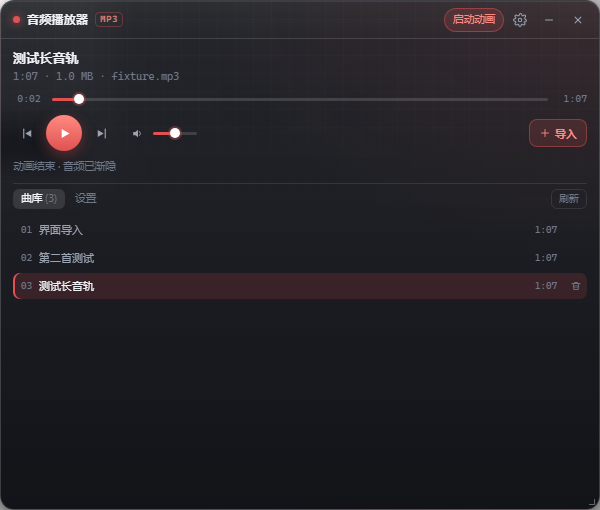

# dsh-audio-player

一个 DSH 内的 MP3 音频播放器：**导入自己喜欢的音乐，用独立悬浮窗播放；如果 DSH 有启动动画（优先适配长征机启动动画），还可以开启「启动动画同步播放」**。

播放器使用自己的 `HTMLAudioElement`，不会暂停、静音或改动 DSH、启动动画、语音播报以及其它插件的任何声音。



---

## 简介

- **一个 DSH 内的 MP3 播放器**：不依赖系统播放器，不跳出 DSH。
- **用户自行导入喜欢的音乐**：支持文件选择、多选、拖放；MP3 会真正保存进 DSH 数据目录，重启后仍在。
- **启动动画同步**：如果当前有启动动画（优先识别长征机 / `dsh-startup-secret`，其次 `dsh-theme-prts` 的启动动画），切到「启动动画」模式后，动画一开始就从 `0:00` 播放选中的音乐；动画结束的瞬间开始渐隐并停止。
- **可调大小的悬浮窗**：拖动标题栏移动，拖右边缘 / 下边缘 / 右下角缩放；折叠、隐藏、位置和尺寸都会记住。

## 功能

| 功能 | 说明 |
|---|---|
| 导入 MP3 | 点「导入」选择文件，或直接把 MP3 拖进悬浮窗；支持多选。 |
| 曲库 | 自动记录标题、时长、大小；点选播放，双击直接播放。 |
| 直接播放 | 播放 / 暂停、上一首 / 下一首、拖动进度、音量、静音、循环。 |
| 启动动画同步 | 从 `0:00` 播放；动画结束立即渐隐并停止。音频比动画长时只保留与动画时长相同的最前段；比动画短时放完即止。 |
| 结束渐隐 | 0–3 秒可调，默认 1.2 秒。 |
| 独立音频 | 只创建自己的音频元素，不碰其它插件的声音。 |
| 悬浮窗 | 拖动、缩放、折叠、收起为右下角悬浮球；设置与曲库都在窗内。 |
| 持久化 | 音乐、曲库、音量、模式、窗口位置都保存在 DSH 数据目录。 |

## 启动动画兼容

启动动画同步不是固定时长，而是监听动画的真实生命周期：

| 启动动画 | 开始信号 | 结束信号 |
|---|---|---|
| **长征机启动动画**（`dsh-startup-secret`，优先） | `#dsh-startup-root` 移除 `dsu-boot` | root 移除 / `dsh-startup:done` 事件 |
| `dsh-theme-prts` 自带启动动画 | `html[data-prts-startup-active]` 出现 | 该属性移除 / 覆盖层移除 |
| 没有启动动画 | 不会播放 | — |

如果动画被跳过（例如本次会话已播放过），本次启动音频也不会擅自播放。

> 浏览器 / Electron 的自动播放策略可能要求一次点击后才能出声。如果启动音频被拦截，播放器会等待页面上的第一次点击，再把音频对齐到动画当前进度继续播放。

## 安装

### 从 GitHub 安装（Web profile）

```bash
dsh plugin --profile web add github:edgewalker6666/dsh-audio-player
```

安装后重启 `dsh web`，刷新页面。

### 本地脚本安装（桌面端推荐）

在插件目录运行：

```powershell
powershell -ExecutionPolicy Bypass -File .\install.ps1 -Profile desktop
```

脚本会：

1. 建 `%USERPROFILE%\.dsh\profiles\<profile>\node_modules\dsh-audio-player` 目录联接；
2. 桌面端向 profile 的 `cordis.patch.yml` 追加 `insert` 行；
3. Web 端向 `dsh.profile.bundles` 追加 `dsh-audio-player`；
4. 在 profile 的 `package.json` 里登记本地依赖，避免 pnpm 之后清理 `node_modules`。

安装完**退出并重新打开 DSH**（桌面端启动时会缓存 index 注入表，只刷新页面不会加载新的悬浮窗脚本）；Web 端重启 `dsh web` 后刷新页面。

手动安装步骤见 [INSTALL.md](INSTALL.md)。

## 使用

1. 打开播放器，点「导入」选择 MP3，或把文件拖进悬浮窗。
2. 在「曲库」里选中一首；双击可直接播放。
3. 顶部模式按钮在 **直接播放 / 启动动画** 之间切换，也可以进「设置」切换。
4. 设置里可以调：直接播放音量、启动动画音量、结束渐隐、循环、重置窗口、打开音频文件夹、复制路径。
5. 拖动标题栏移动；拖右边缘 / 下边缘 / 右下角缩放；`–` 折叠，`×` 收成右下角悬浮球。

把 MP3 直接复制进 `tracks/` 也可以：复制完点「刷新」，播放器会分配文件名、补进曲库；曲库里已失效的文件也会被清掉。

## 数据位置

| 内容 | 路径 |
|---|---|
| 插件本体 | `%USERPROFILE%\.dsh\plugins\dsh-audio-player\` |
| 导入的 MP3 | `%USERPROFILE%\.dsh\dsh-audio-player\tracks\` |
| 曲库索引 | `%USERPROFILE%\.dsh\dsh-audio-player\library.json` |
| 播放器设置 | `%USERPROFILE%\.dsh\dsh-audio-player\config.json` |

## 技术说明

- **零运行时依赖**：只用 Node 内置模块与浏览器原生 API。
- **宿主路由**：`/dsh-audio-player/app.js`、`/app.css`、`/api/state`、`/api/config`、`/api/tracks`、`/api/media/<id>`（支持 HTTP Range，可拖动进度）。
- **跨端加载**：通过 `webserver/index-inject` 的结构化注入行加载；Web 端由 `frontend-static` 渲染，桌面端由 `dsh-app://` 启动壳执行。
- **安全**：所有自定义路由都经过 DSH `connection` 的浏览器信任栅栏；未认证请求返回 401。
- **隔离**：播放器 UI 在 Shadow DOM 内，样式不会泄漏到 DSH；宿主只创建一个 `#dsh-audio-player-host` 节点，不改 DSH 的 React 树。
- **层叠**：悬浮窗 `z-index: 2147482000`，低于启动动画的 `2147483000`，启动期间被动画盖住，不干扰启动画面。

## 兼容性

| 项 | 要求 |
|---|---|
| DSH | 0.2.1-rc.3（web profile / 桌面端） |
| Node | >= 20 |
| 浏览器 | Chromium（Electron / Edge / Chrome），需要 HTMLAudioElement 与 Shadow DOM |
| MP3 | 标准 MPEG 音频（ID3v2 或无 ID3 的帧同步均可），单文件 <= 200 MB |

## 卸载

```powershell
powershell -ExecutionPolicy Bypass -File .\uninstall.ps1 -Profile desktop
```

只移除安装登记与 `node_modules` 联接，**不会删除** `~/.dsh/dsh-audio-player/` 里的音频和设置。

## 排查

| 现象 | 处理 |
|---|---|
| 重启后没有悬浮窗 | 确认插件目录在 profile 的 `node_modules` 下；桌面端确认 `cordis.patch.yml` 里有 `- id: dsh-audio-player`；确认没有重复登记（bundle + patch）。 |
| 悬浮窗出现但提示「宿主未响应」 | 宿主半侧没加载（401/404）。看 DSH 日志里有没有 `[dsh-audio-player]` 的报错。 |
| 启动动画模式不出声 | 检查是否选了曲目、模式是否为「启动动画」；若是自动播放拦截，点一次页面即可。 |
| 启动音频和动画对不上 | 播放器按动画真实结束时刻渐隐，不以固定时长裁剪；动画被跳过时本次不播放。 |
| 导入提示 415 | 文件不是有效 MP3（需要 ID3 或 MPEG 帧同步头）。 |

## License

[MIT](LICENSE)
